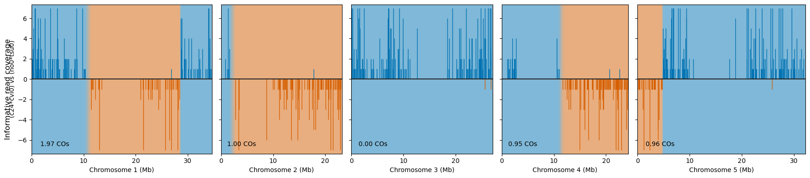

<picture>
  <source
    srcset="images/logo.png"
    media="(orientation: portrait)" />
  
</picture>

## **coelsch**: <ins>C</ins>ross<ins>o</ins>ver <ins>e</ins>stimation, <ins>l</ins>ocalisation and <ins>s</ins>ingle <ins>c</ins>ell <ins>h</ins>aplotyping

#### (formerly known as `snco`)

`coelsch` is a toolkit for haplotype marker processing and crossover inference from sequencing data. It supports both single-cell/nucleus datasets and bulk or plate-based progeny resequencing datasets. Reads or SNP counts are summarised into binned haplotype marker records, optionally cleaned and normalised, then analysed with a rigid hidden Markov model to infer haplotype inheritance and crossover locations.

The current design-aware workflow supports haploid recombinant gametes as well as progeny designs including F2, backcross, testcross, three-way and four-way crosses. Experimental design metadata is stored with marker and prediction JSON files so downstream commands can interpret haplotype channels consistently.

`coelsch` is under active development. JSON formats and some command-line options may change between major versions; when in doubt, regenerate intermediate marker/prediction files with the same version used for downstream analysis.

### Installation

The easiest way to install `coelsch` is using the provided conda environment:

```bash
git clone https://github.com/schneebergerlab/coelsch.git
cd coelsch
conda env create -f coelsch.yml
```

Alternatively, install with pip:

```bash
pip install git+https://github.com/schneebergerlab/coelsch.git
```

`coelsch` uses `torch` and `pomegranate>=1.0` for crossover inference, `pysam` and `joblib` for BAM processing, and `numpy`, `pandas`, `scipy` and `matplotlib` for marker analysis and plotting. The command-line interface is built with `click`.

### Workflow

The recommended workflow is modular:

```bash
coelsch loadbam ... -o markers_init.json input.bam
coelsch clean markers_init.json -o markers_filt.json
coelsch predict markers_filt.json -o pred.json
```

For SNP matrix input generated by `cellsnp-lite`, use `loadcsl` instead of `loadbam`:

```bash
coelsch loadcsl ... -o markers_init.json cellsnp_lite_dir
```

The output of `loadbam` or `loadcsl` is a `MarkerRecords` JSON file. The output of `predict` is a `PredictionRecords` JSON file. These records can be passed to `clean`, `predict`, `stats`, `segdist`, `plot`, `sim` and `inspect` as appropriate.

To run the full `load -> clean -> predict` workflow in one command, the combined commands such `bam2pred` and `csl2pred` are available.

### Experimental Design

The `loadbam` and `loadcsl` commands that construct marker records need enough information to describe the biological design:

```bash
--lifecycle-stage gametes|progeny
--crossing-strategy f1|f2|backcross|testcross|three_way|four_way
--genotyping-strategy auto|founder|recombinant
--crossing-combinations "(col0*(col0*ler))"
--sample-unit auto|single_cell|bulk
```

Crossing combinations use genotype expressions such as:

```text
(col0*ler)                # F1
(col0*(col0*ler))         # backcross
(col0*(ler*cvi0))         # testcross
((col0*ler)*(col0*cvi0))  # three_way
((col0*ler)*(cvi0*ws4))   # four_way
(col0[f]*ler[m])          # F1 with crossing direction defined
```

The crossing strategy determines the expected haplotype channels, possible inheritance states, expected marker ratios and how crossovers are interpreted. When more than one genotype is provided (as a comma separated list) to `--crossing-combinations`, genotyping mode is switched on and barcodes will be assigned to the provided genotypes using expectation maximisation, for instance:

```bash
--lifecycle-stage gametes
--crossing-strategy f1
--genotyping-strategy founder
--crossing-combinations "(col0*ler0),(col0*cvi0),(col0*ws4)"
--sample-unit single_cell
```

is the standard design for pooled pollen sequencing from F1 hybrids, and barcodes will be genotyped based on the number of reads mapping to Ler-0, Cvi-0 or Ws-4 respectively.

`coelsch` also supports more complex designs where pre-meiotic genotypes are themselves recombinants of founder haplotypes. This can be switched on by setting `--genotyping-strategy=recombinant` and providing a `PredictionRecords` json of recombinant diploid genotypes using `--recombinant-parent-json` to `loadbam` or `loadcsl`:

```bash
--lifecycle-stage gametes
--crossing-strategy f1
--genotyping-strategy recombinant
--recombinant-parent-json diploid_genotypes.json
--sample-unit single_cell
```

In this mode, gametes will be assigned to these recombinant genotypes before identification of new recombination events occurs.

### Input Types

`loadbam` reads BAM files containing cell/sample barcode tags and haplotype tags. It is intended for BAMs produced by haplotype-aware alignment workflows, including the accompanying `coelsch_mapping_pipeline` Snakemake workflow.

`loadcsl` reads `cellsnp-lite` matrix output and a VCF describing parental SNPs. For simple designs, reference/alternative alleles can be interpreted as placeholder haplotypes. For more complex founder designs, the experimental design metadata determines how haplotypes are represented downstream.

### Record JSONs

`MarkerRecords` store binned marker counts for each barcode/sample, chromosome and haplotype channel.

`PredictionRecords` store predicted marginal haplotype dosages or probabilities for each barcode/sample and genomic bin. For multihaplotype designs, columns correspond to haplotype channels. For two-haplotype records, some APIs may expose a scalar representation, but helper methods can recover matrix-shaped haplotype dosage output.

Marker and Prediction JSONs are encoded using sparse or rle compression to reduce file size. The encoded files should be read through `MarkerRecords.read_json()` `PredictionRecords.read_json()` or `coelsch.utils.load_json()` rather than parsed manually.

Use `inspect` to check record contents:

```bash
coelsch inspect pred.json
coelsch inspect pred.json --metadata
coelsch inspect pred.json --barcodes # prints all barcodes as plain text
coelsch inspect pred.json --cb-whitelist-fn barcodes.txt # filter using barcodes.txt
```

### Python API

`coelsch` provides Python classes for working with marker and prediction records:

```python
from coelsch import MarkerRecords, PredictionRecords

co_markers = MarkerRecords.read_json('markers_filt.json')
co_preds = PredictionRecords.read_json('pred.json')

co_markers.barcodes[:5]
co_preds.get_haplotype_dosage(cb='sample_001', chrom='chr1')
```

Plotting is available from the command line with `coelsch plot` and from Python through `coelsch.plot` or record helper methods:

```python
co_markers.plot_barcode('GCTATCCCAAGTAGAG', co_preds=co_preds)
```


